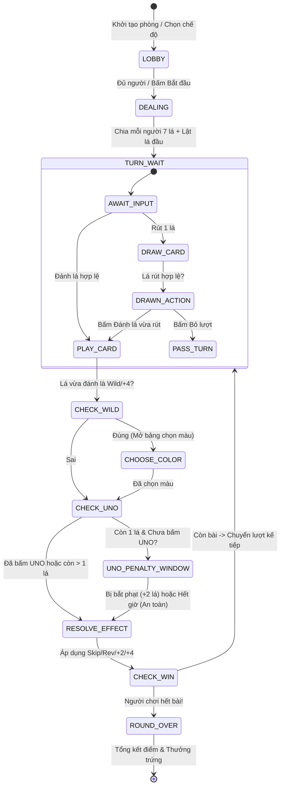

# TÀI LIỆU ĐẶC TẢ THIẾT KẾ & KỸ THUẬT GAME UNO TRONG DỰ ÁN OFFLINE-FALLBACK
## (UNO GAME FULL ARCHITECTURE & IMPLEMENTATION SPECIFICATION)

> **Mục tiêu**: Tích hợp game bài quốc tế **UNO** vào hệ thống `offline-fallback` với 2 chế độ hoàn chỉnh: **Chơi với máy (PvE)** và **Đấu mạng nhiều người (Multiplayer Room 2–4 người)**. Game tận dụng tối đa bộ sprite bài SVG (`deck.svg` và `uno.svg`) từ mã nguồn tham khảo của Izan Pérez Cosano, chuẩn hóa thuật toán luật chơi quốc tế, tối ưu hóa trải nghiệm người dùng (UX/UI phong cách Glassmorphism 3D hiện đại) và tích hợp liền mạch vào hạ tầng Cloudflare Workers / Durable Objects cũng như máy chủ phát triển Node.js cục bộ.

---

## 1. PHÂN TÍCH THUẬT TOÁN & BỘ ASSETS TỪ TÀI LIỆU THAM KHẢO

Dựa trên 2 bài viết tại `https://eperezcosano.github.io/uno-part1/`, `uno-part2/` và repository gốc `eperezcosano/Uno`, chúng ta rút ra được các thuật toán cốt lõi, đồng thời nhận diện các điểm thiếu sót cần khắc phục triệt để.

### 1.1. Giải Mã Cấu Trúc Sprite Sheet Bài (`deck.svg`)

Tài nguyên sprite bài `deck.svg` được thiết kế dưới dạng một ma trận lưới 2D chuẩn:
- **Kích thước một lá bài (Cell Size)**: Rộng $cdWidth = 240\text{px}$, Cao $cdHeight = 360\text{px}$ (Tỷ lệ $2:3$).
- **Cấu trúc ma trận**: **14 Cột (Cols)** $\times$ **8 Hàng (Rows)** = $112$ ô bài.

```
       Cột:  0   1   2   3   4   5   6   7   8   9   10   11   12   13
Hàng 0: Đỏ  [0] [1] [2] [3] [4] [5] [6] [7] [8] [9] [Skip][Rev][+2] [Wild]
Hàng 1: Vàng[0] [1] [2] [3] [4] [5] [6] [7] [8] [9] [Skip][Rev][+2] [Wild]
Hàng 2: Xanh[0] [1] [2] [3] [4] [5] [6] [7] [8] [9] [Skip][Rev][+2] [Wild]
Hàng 3: Lam [0] [1] [2] [3] [4] [5] [6] [7] [8] [9] [Skip][Rev][+2] [Wild]
Hàng 4: Đỏ  [x] [1] [2] [3] [4] [5] [6] [7] [8] [9] [Skip][Rev][+2] [+4]
Hàng 5: Vàng[x] [1] [2] [3] [4] [5] [6] [7] [8] [9] [Skip][Rev][+2] [+4]
Hàng 6: Xanh[x] [1] [2] [3] [4] [5] [6] [7] [8] [9] [Skip][Rev][+2] [+4]
Hàng 7: Lam [x] [1] [2] [3] [4] [5] [6] [7] [8] [9] [Skip][Rev][+2] [+4]
```

#### Đường Dẫn Lưu Trữ & Phân Phát Ảnh (Cloudflare R2 Endpoints):
Toàn bộ ảnh thẻ bài đã được tải lên Cloudflare R2 bucket `offline-fallback-images` và được phục vụ độc lập qua tuyến an toàn `/__assets/`:
- **Sprite Sheet 112 lá mặt trước**: `/__assets/uno_deck.svg` (302.6 KB, Cache 1 năm, ETag 304).
- **Mặt sau lá bài UNO**: `/__assets/uno.svg` (6.2 KB, Cache 1 năm, ETag 304).
- **Icon Hộp trứng thưởng**: `/__assets/egg_icon.webp` (8.2 KB).

Cách khởi tạo ảnh trên Canvas Client:
```javascript
const cards = new Image();
cards.src = '/__assets/uno_deck.svg';

const cardBack = new Image();
cardBack.src = '/__assets/uno.svg';
```
*(Cơ chế fallback: Trong môi trường dev local `npm run dev`, `scripts/local-server.mjs` tự động phục vụ trực tiếp từ thư mục `assets/` mà không cần kết nối mạng).*

#### Công Thức Ánh Xạ Thẻ Bài (Card Mapping Formulas):
Mỗi lá bài được đại diện bởi một số nguyên duy nhất $N \in [0, 111]$:
1. **Cột (Column)**: $\text{col} = N \pmod{14}$
2. **Hàng (Row)**: $\text{row} = \lfloor N / 14 \rfloor$
3. **Tọa độ cắt trên Sprite Sheet (`/__assets/uno_deck.svg`)**:
   $$\text{sx} = 1 + 240 \times \text{col}$$
   $$\text{sy} = 1 + 360 \times \text{row}$$
   $$\text{sWidth} = 240, \quad \text{sHeight} = 360$$
4. **Vẽ lên Canvas**:
   ```javascript
   ctx.drawImage(cards, sx, sy, 240, 360, destX, destY, cardWidth, cardHeight);
   ```
5. **Mặt sau lá bài (`/__assets/uno.svg`)**: Ảnh đơn chứa mặt lưng màu đen viền vàng với logo UNO elip đỏ kinh điển, hiển thị cùng kích thước tỷ lệ $2:3$:
   ```javascript
   ctx.drawImage(cardBack, 0, 0, 240, 360, destX, destY, cardWidth, cardHeight);
   ```

#### Thuật Toán Khởi Tạo Bộ Bài 108 Lá Chuẩn:
Trong luật UNO quốc tế của Mattel, mỗi màu có duy nhất **một lá số 0** (tổng cộng 4 lá 0), và hai lá cho các số từ 1 đến 9 cùng các lá chức năng. Sprite grid $14 \times 8 = 112$ ô đã thừa ra 4 lá số 0 ở hàng 4, 5, 6, 7 (đánh dấu `[x]` ở sơ đồ trên).
Thuật toán loại bỏ 4 lá trùng trong mảng ban đầu:
```javascript
// Tạo mảng 112 ID từ 0 đến 111
const deck = Array.from({ length: 112 }, (_, i) => i);
// Loại bỏ 4 lá 0 thừa: ID 56 (Đỏ), 70 (Vàng), 84 (Xanh lá), 98 (Xanh dương)
deck.splice(56, 1); // Xóa 56, các phần tử phía sau lùi 1 vị trí
deck.splice(69, 1); // 70 - 1 = 69
deck.splice(82, 1); // 84 - 2 = 82
deck.splice(95, 1); // 98 - 3 = 95
// Kết quả: Mảng deck còn chính xác 108 lá bài chuẩn UNO!
```

#### Bảng Thuộc Tính Lá Bài Từ ID $N$:
| Thuộc tính | Biểu thức Logic | Giá trị khả dĩ |
|---|---|---|
| **Màu sắc (`color`)** | `col === 13 ? 'black' : ['red', 'yellow', 'green', 'blue'][row % 4]` | `'red'`, `'yellow'`, `'green'`, `'blue'`, `'black'` |
| **Loại thẻ (`type`)** | `col === 10 ? 'skip' : col === 11 ? 'reverse' : col === 12 ? 'draw2' : col === 13 ? (row >= 4 ? 'draw4' : 'wild') : 'number'` | `'number'`, `'skip'`, `'reverse'`, `'draw2'`, `'wild'`, `'draw4'` |
| **Giá trị (`value`)** | `col < 10 ? col : null` | Số $0 \dots 9$ hoặc null |
| **Điểm số (`score`)** | `col < 10 ? col : (col < 13 ? 20 : 50)` | $0 \dots 9$ điểm (số), 20 điểm (hành động), 50 điểm (Wild/+4) |

---

### 1.2. Đánh Giá Thuật Toán Trong Bài Viết & Các Điểm Cần Cải Tiến

| Hạng mục | Triển khai trong bài viết gốc | Hạn chế / Sai sót | Giải pháp nâng cấp trong dự án |
|---|---|---|---|
| **Xác định lượt & Đổi chiều** | `turn = (turn + (-1)**reverse) % people` | Lỗi toán tử khi ra số âm trong JavaScript (`(-1) % 4 === -1` gây crash mảng). Chưa xử lý luật 2 người chơi. | Dùng công thức mô-đun chuẩn: `(turn + step * dir + numPlayers) % numPlayers`. Trong ván **2 người**, lá **Reverse hoạt động như lá Skip**. |
| **Chọn màu khi đánh Wild** | Chỉ có hàm `chooseColor()` vẽ cung tròn trên Canvas, chưa gửi dữ liệu lên server; server giữ màu `'black'`. | Lượt tiếp theo không biết màu nào hợp lệ để đánh tiếp. | Thêm pha trạng thái `CHOOSE_COLOR`. Người đánh lá Wild/+4 phải chọn 1 trong 4 màu. Server lưu `activeColor` riêng biệt với `topCard.color`. |
| **Hết chồng bài rút (Draw Pile)** | Rút bằng `deck.shift()`, không tái chế cọc bài đã đánh. | Khi ván đấu kéo dài, `deck` cạn về 0 khiến server văng lỗi hoặc không thể rút tiếp. | Tái chế cọc bài đã đánh: Giữ lại lá trên cùng làm `topCard`, lấy toàn bộ cọc đánh, xáo trộn bằng Fisher-Yates làm cọc rút mới. |
| **Luật Rút Bài (Draw & Play)** | Bấm rút bài là tự động chuyển lượt cho người kế tiếp. | Không đúng luật UNO: Người chơi rút 1 lá, nếu lá đó đánh được thì **được quyền đánh ngay lập tức** hoặc chọn bỏ lượt (Pass). | Hỗ trợ 2 bước: Sau khi rút, nếu lá bài hợp lệ, hiển thị nút "Đánh lá vừa rút" hoặc "Giữ bài & Bỏ lượt". |
| **Cơ chế Nói UNO & Bắt Phạt** | Hoàn toàn chưa có. | Mất đi tính năng kinh điển và hấp dẫn nhất của trò chơi UNO. | Thêm nút **"Nói UNO!"** khi còn 2 lá chuẩn bị đánh 1. Mở cửa sổ 2.5 giây cho đối thủ/bot bấm **"Bắt UNO!"** nếu quên bấm. Phạt rút 2 lá. |
| **Bảo mật & Chống gian lận** | Server gửi toàn bộ mảng bài cho client khác (`haveCard`). | Người chơi có thể mở DevTools để xem bài của đối thủ. | **Anti-cheat Hand Masking**: Server chỉ gửi mảng lá bài cho chính chủ, đối thủ chỉ nhận `cardCount` và mảng ẩn `null`. |
| **AI Chơi Đơn (PvE)** | Không có bot, chỉ hỗ trợ multiplayer 2 người. | Không thể chơi offline hoặc khi chờ người khác. | Xây dựng Bot AI hoàn chỉnh với 3 cấp độ (Dễ, Vừa, Khó) có khả năng tính toán màu chủ lực, thời điểm xả bài phạt và tự động bắt phạt UNO. |

---

## 2. LUẬT CHƠI UNO CHUẨN QUỐC TẾ (OFFICIAL GAME RULES)

### 2.1. Thiết Lập Ban Đầu (Game Setup)
1. Số người chơi: **2 đến 4 người** (PvE: 1 người chơi + 1 đến 3 bot; PvP: 2 đến 4 người chơi trực tuyến).
2. Chia bài: Mỗi người chơi nhận đúng **7 lá bài**.
3. Lá bài mở đầu (Starting Card):
   - Rút 1 lá từ cọc rút đặt vào cọc đánh (Discard Pile).
   - Nếu lá mở đầu là **Wild Draw 4 (+4)**: Trả lại cọc bài, xáo lại và rút lá khác.
   - Nếu là **Wild**: Người chơi đầu tiên (bên trái người chia bài) được quyền chọn màu khởi động.
   - Nếu là **Draw 2 (+2)**: Người chơi đầu tiên phải rút 2 lá và mất lượt.
   - Nếu là **Reverse**: Chiều đánh đảo ngược (trong ván 2 người: người chơi đầu bị mất lượt, quyền đánh về lại người chia).
   - Nếu là **Skip**: Người chơi đầu tiên bị mất lượt.

### 2.2. Điều Kiện Đánh Bài Hợp Lệ (Valid Play Conditions)
Một lá bài trên tay được coi là hợp lệ khi thỏa mãn **ít nhất một** trong các điều kiện sau:
1. **Cùng màu**: Lá bài có màu trùng với màu hiện tại (`activeColor`).
2. **Cùng số hoặc ký hiệu**:
   - Lá số cùng giá trị số với lá trên bàn (ví dụ: Số 7 Đỏ đè lên Số 7 Xanh).
   - Lá chức năng cùng loại với lá trên bàn (ví dụ: Skip Vàng đè lên Skip Đỏ).
3. **Lá bài đổi màu (Wild Card)**: Luôn luôn được phép đánh ở mọi thời điểm.
4. **Lá bài Wild Draw 4 (+4)**: Luôn được phép đánh (hỗ trợ luật thoải mái phổ biến trong video game).

```
                      +-----------------------------+
                      |   Lá trên cùng cọc đánh     |
                      |   (Top Card: Red 7)         |
                      |   Màu hiện tại: RED         |
                      +--------------+--------------+
                                     |
              +----------------------+----------------------+
              |                      |                      |
     [CÙNG MÀU: RED]        [CÙNG SỐ: 7]          [ĐẶC BIỆT: WILD]
      Ví dụ: Red 3,          Ví dụ: Blue 7,        Ví dụ: Wild,
      Red Skip, Red +2       Yellow 7, Green 7     Wild Draw 4 (+4)
```

### 2.3. Hiệu Ứng Các Lá Bài Chức Năng (Action Cards)
- **Skip (Cấm lượt)**: Người chơi kế tiếp theo chiều đánh bị mất lượt.
- **Reverse (Đổi chiều)**:
  - Ván 3–4 người: Đổi chiều xoay từ Thuận chiều kim đồng hồ $\leftrightarrow$ Ngược chiều kim đồng hồ.
  - Ván 2 người: Tương đương một lá **Skip** (đối thủ mất lượt, người vừa đánh tiếp tục được đi).
- **Draw 2 (+2)**: Người chơi kế tiếp bị phạt rút 2 lá và mất lượt.
- **Wild (Đổi màu tự do)**: Người đánh được chọn màu mới cho vòng tiếp theo (`red`, `yellow`, `green`, `blue`).
- **Wild Draw 4 (+4)**: Người đánh được chọn màu mới, người chơi kế tiếp bị phạt rút 4 lá và mất lượt.

### 2.4. Luật Rút Bài, Bỏ Lượt & Hết Cọc Rút
- Khi đến lượt, nếu không có lá bài nào hợp lệ (hoặc người chơi chủ động giữ bài chiến thuật), người chơi bấm vào **Cọc bài úp (Draw Pile)** để rút **1 lá**.
- **Quyền đánh ngay**: Nếu lá vừa rút hợp lệ với bàn cờ, người chơi có 5 giây để quyết định:
  - Bấm vào lá bài vừa rút để đánh ra bàn.
  - Hoặc bấm nút **"Bỏ lượt (Pass)"** để giữ lá đó trên tay và chuyển lượt cho người kế tiếp.
- **Hết cọc bài rút**: Khi số bài trong cọc rút còn dưới 2 lá, hệ thống tự động gom toàn bộ các lá bài phía dưới của cọc đánh, thực hiện Fisher-Yates Shuffle để tái tạo cọc rút mới.

### 2.5. Cơ Chế Nói UNO! & Bắt Phạt (UNO Call & Catch)
- Khi một người chơi chỉ còn lại **2 lá bài trên tay** và thực hiện đánh ra 1 lá (chuẩn bị còn đúng 1 lá), người chơi **BẮT BUỘC** phải bấm nút **"NÓI UNO!"** trước hoặc đồng thời khi đánh lá bài.
- **Cửa sổ bắt phạt (Penalty Window - 2.5 giây)**:
  - Nếu người chơi đánh xuống còn 1 lá mà **chưa bấm UNO**: Cửa sổ 2.5 giây sẽ kích hoạt.
  - Bất kỳ đối thủ hoặc Bot nào bấm nút **"BẮT UNO!"** trong thời gian này: Người chơi vi phạm bị phạt rút ngay lập tức **2 lá bài**.
  - Nếu hết 2.5 giây mà không ai phát hiện, hoặc lượt đánh của người kế tiếp đã bắt đầu: Người chơi thoát phạt an toàn.

### 2.6. Điều Kiện Thắng & Tính Điểm (Scoring)
- Người chơi đầu tiên đánh hết toàn bộ bài trên tay là người chiến thắng vòng đấu.
- **Điểm thưởng ván thắng**: Người thắng nhận tổng số điểm từ các lá bài còn sót lại trên tay tất cả đối thủ:
  - Các lá số $0 \dots 9$: Tính theo giá trị mặt lá ($0 \dots 9$ điểm).
  - Các lá Skip, Reverse, Draw 2: **20 điểm / lá**.
  - Các lá Wild, Wild Draw 4: **50 điểm / lá**.
- **Tích hợp Mebi Farm Egg Currency**:
  - Thắng ván: Nhận **+5 Hộp Trứng** (`egg_currency_balance`).
  - Điểm số ván đấu: Cứ mỗi 100 điểm thưởng quy đổi thêm **+1 Hộp Trứng**.

---

## 3. MÁY TRẠNG THÁI VÁN ĐẤU (FINITE STATE MACHINE - FSM)

Toàn bộ ván đấu được điều phối bởi FSM xác định, đảm bảo tính đồng bộ tuyệt đối giữa Server Durable Object và Client:



---

## 4. BỘ NÃO TRÍ TUỆ NHÂN TẠO CHO BOT (BOT AI ENGINE)

Game hỗ trợ 3 cấp độ Bot, mô phỏng phản xạ tự nhiên của người thật:

### 4.1. Mức Dễ (Easy Bot - Gà Mới)
- Đánh ngẫu nhiên một lá bài hợp lệ trong tay.
- Khi đánh Wild/+4: Chọn màu ngẫu nhiên trong 4 màu.
- Tỉ lệ nhớ bấm "Nói UNO!": **50%**.
- Tỉ lệ bắt phạt UNO đối thủ: **20%** (Độ trễ phản xạ $1.8\text{s} - 2.4\text{s}$).

### 4.2. Mức Vừa (Medium Bot - Tiêu Chuẩn)
- **Ưu tiên giữ màu chủ lực**: Đếm số lượng màu trong tay, ưu tiên đánh các lá có màu mà tay mình đang sở hữu nhiều nhất.
- **Tiết kiệm lá chức năng**: Chỉ đánh lá +2, Skip, Reverse khi màu hiện tại sắp hết lá số hoặc khi đối thủ kế tiếp còn $\le 3$ lá.
- Khi đánh Wild: Chọn màu mà bot đang có nhiều lá nhất.
- Tỉ lệ nhớ bấm "Nói UNO!": **85%**.
- Tỉ lệ bắt phạt UNO đối thủ: **70%** (Độ trễ phản xạ $1.0\text{s} - 1.5\text{s}$).

### 4.3. Mức Khó (Hard Bot - Bậc Thầy Chiến Thuật)
- **Theo dõi mối đe dọa (Threat Assessment)**:
  - Kiểm tra số lượng bài của người chơi kế tiếp theo chiều đánh. Nếu đối thủ chỉ còn $1 \dots 2$ lá, Bot sẽ **tất tay tung lá +2, +4, Skip hoặc Reverse** để chặn đứng đối thủ ngay lập tức.
  - Ghi nhớ các màu mà đối thủ từng phải rút bài (màu yếu của đối thủ) để khi đánh Wild sẽ ép sang màu đó.
- **Tối ưu hóa điểm số**: Ưu tiên xả các lá có giá trị điểm phạt cao (Wild = 50, +2/Skip/Rev = 20) khi ván đấu có dấu hiệu sắp kết thúc.
- Tỉ lệ nhớ bấm "Nói UNO!": **100%**.
- Tỉ lệ bắt phạt UNO đối thủ: **95%** (Độ trễ cực nhạy $0.4\text{s} - 0.8\text{s}$).

---

## 5. THIẾT KẾ GIAO DIỆN & TRẢI NGHIỆM NGƯỜI DÙNG ĐỈNH CAO (UX/UI EXCELLENCE)

Không dùng giao diện Canvas phẳng đơn điệu như bản mẫu, UNO trong dự án được thiết kế theo chuẩn **AAA Web Card Game**:

```
+---------------------------------------------------------------------------------+
|  [◀ Thoát]     PHÒNG: UN88  •  4 NGƯỜI  •  LƯỢT: BẠN (18s)         [🔊] [⚙️]    |
|                                                                                 |
|                       +--------------------------+                              |
|                       |  BOT 2 (Minh Anh)  [3 lá]|                              |
|                       |  🂠 🂠 🂠                  |                              |
|                       +--------------------------+                              |
|                                                                                 |
|   +-------------------+                                  +-------------------+  |
|   | BOT 1 (Tuấn Hải)  |        CHIỀU ĐÁNH: ↻ (THUẬN)     | BOT 3 (Hương Ly)  |  |
|   | [5 lá]            |                                  | [2 lá - ⚠️ UNO!]  |  |
|   | 🂠 🂠 🂠 🂠 🂠        |       [CỌC RÚT]    [CỌC ĐÁNH]    | 🂠 🂠               |  |
|   +-------------------+        +-------+    +-------+    +-------------------+  |
|                                |  UNO  |    | RED 7 |                           |
|                                | (ÚP)  |    | (MỞ)  |                           |
|                                +-------+    +-------+                           |
|                                     MÀU HIỆN TẠI: ĐỎ 🔴                         |
|                                                                                 |
|             [ 🔥 NÓI UNO! ]             [ ⚡ BẮT UNO! (2.1s) ]                  |
|                                                                                 |
|                     BÀI CỦA BẠN (7 LÁ - RÊ CHUỘT ĐỂ XÒE BÀI):                   |
|        /---\    /---\    /---\    /---\    /---\    /---\    /---\              |
|        |R 3|    |R +2|   |Y 7|    |G 5|    |B Sk|   |WILD|   |W +4|             |
|        \---/    \---/    \---/    \---/    \---/    \---/    \---/              |
|       (Sáng)   (Sáng)   (Sáng)    (Tối)    (Tối)   (Sáng)   (Sáng)              |
+---------------------------------------------------------------------------------+
```

### 5.1. Bảng Màu & Ngôn Ngữ Thiết Kế (Design System)
- **Tông màu chủ đạo**: Nền nỉ nhung dạ hội sang trọng với dải gradient sâu `#0F172A` $\to$ `#1E293B`, làm nổi bật các sắc màu rực rỡ của lá bài UNO.
- **Màu bài UNO chuẩn**:
  - Đỏ (Red): `#EF4444` (Glow: `rgba(239, 68, 68, 0.4)`)
  - Vàng (Yellow): `#F59E0B` (Glow: `rgba(245, 158, 11, 0.4)`)
  - Xanh lá (Green): `#10B981` (Glow: `rgba(16, 185, 129, 0.4)`)
  - Xanh dương (Blue): `#3B82F6` (Glow: `rgba(59, 130, 246, 0.4)`)
  - Thẻ đen (Wild): Radial Rainbow Gradient rực rỡ.

### 5.2. Hiệu Ứng Tương Tác & Chuyển Động (Animations & FX)
1. **Xòe bài cánh quạt 3D (Fan-out Hand Layout)**:
   - Các lá bài trên tay người chơi được xếp cong nhẹ theo hình vòng cung với góc nghiêng tự nhiên từ $-15^\circ$ đến $+15^\circ$.
   - Khi hover chuột (hoặc chạm trên mobile): Lá bài nhô cao lên $28\text{px}$, phóng to $1.15\times$, đổ bóng mềm kèm viền phát sáng viền neon.
2. **Lọc bài thông minh (Smart Playability Glow)**:
   - Trong lượt của người chơi, các lá bài **hợp lệ sẽ phát sáng viền pulsating glow**. Các lá bài không hợp lệ sẽ tự động hạ độ sáng xuống 50% (dimmed), giúp người chơi nhận biết bài đánh được ngay trong tích tắc mà không cần nhớ luật.
3. **Vòng xoay đổi màu (Glassmorphism Color Wheel Modal)**:
   - Khi đánh lá Wild hoặc Wild +4, một bánh xe tròn 4 góc 4 màu phong cách kính mờ (Backdrop-filter blur $16\text{px}$) sẽ bung ra ở giữa bàn với animation xoay phóng to ấn tượng.
4. **Vòng tròn chiều đánh (Dynamic Turn Flow Indicator)**:
   - Vòng tròn hạt sáng laser chạy quanh bàn cờ chỉ rõ chiều đánh (Thuận hoặc Ngược). Khi có lá **Reverse**, vòng tròn đảo chiều tức thì kèm hiệu ứng gợn sóng shockwave.
5. **Âm Thanh Chân Thực Không Dùng File Ngoài (Web Audio API)**:
   - Âm thanh quẹt bài (Card Slide swoosh).
   - Âm thanh dập bài xuống bàn (Card Snap thud).
   - Âm chuông báo hiệu lượt đi (Turn Ding chime).
   - Âm thanh còi hú khi có người hô UNO (Uno Horn alert).
   - Pháo hoa giấy (Confetti) và nhạc vinh quang khi chiến thắng ván đấu.

---

## 6. GIAO THỨC TRUYỀN THÔNG MẠNG (MULTIPLAYER PROTOCOL)

Game sử dụng kết nối WebSocket tại tuyến:
`/__game/ws?g=uno&room=<ROOM_CODE>&action=<create|join>&name=<PLAYER_NAME>`

### 6.1. Chi Tiết Các Gói Tin (Packet Schemas)

#### 1. Khởi Tạo & Sảnh Chờ (`lobby`):
```json
// Server -> Client
{
  "t": "lobby",
  "room": "UN88",
  "host": 0,
  "players": [
    { "id": 0, "name": "Nguyễn Văn A", "ready": true, "isBot": false },
    { "id": 1, "name": "Bot Minh Anh", "ready": true, "isBot": true }
  ],
  "maxPlayers": 4
}
```

#### 2. Đồng Bộ Trạng Thái Ván Đấu (`state` - Có Anti-cheat Masking):
```json
// Server -> Client (Gửi riêng cho Player 0)
{
  "t": "state",
  "state": {
    "currentTurn": 0,
    "direction": 1,
    "activeColor": "red",
    "topCard": 42,
    "drawPileCount": 78,
    "unoWindowActive": false,
    "players": [
      { "id": 0, "cardCount": 7, "hand": [1, 15, 29, 43, 57, 13, 27] }, // Chính chủ: Nhận ID bài thật
      { "id": 1, "cardCount": 7, "hand": null },                         // Đối thủ: MẶT BÀI ĐÃ BỊ MASK THÀNH NULL!
      { "id": 2, "cardCount": 6, "hand": null }
    ]
  }
}
```

#### 3. Hành Động Đánh Bài (`play`):
```json
// Client -> Server
{ "t": "play", "cardId": 13, "chosenColor": "yellow", "calledUno": true }

// Server -> All Clients
{ "t": "card_played", "playerId": 0, "cardId": 13, "chosenColor": "yellow", "cardsLeft": 6 }
```

#### 4. Hành Động Rút Bài (`draw`):
```json
// Client -> Server
{ "t": "draw" }

// Server -> Client rút bài
{ "t": "drawn_card", "cardId": 55, "canPlay": true }

// Client -> Server (Nếu chọn bỏ lượt không đánh)
{ "t": "pass" }
```

#### 5. Bắt Phạt UNO (`catch_uno`):
```json
// Client -> Server
{ "t": "catch_uno", "targetId": 2 }

// Server -> All Clients (Thông báo phạt thành công)
{ "t": "uno_penalty", "targetId": 2, "catcherId": 0, "penaltyCards": 2 }
```

#### 6. Kết Thúc Ván & Tổng Kết Điểm (`game_over`):
```json
// Server -> All Clients
{
  "t": "game_over",
  "winnerId": 0,
  "winnerName": "Nguyễn Văn A",
  "roundPoints": 145,
  "eggsEarned": 6,
  "scoreboard": [
    { "id": 0, "name": "Nguyễn Văn A", "remainingCards": 0, "penaltyScore": 0 },
    { "id": 1, "name": "Bot Minh Anh", "remainingCards": 3, "penaltyScore": 65 },
    { "id": 2, "name": "Bot Hương Ly", "remainingCards": 4, "penaltyScore": 80 }
  ]
}
```

---

## 7. CẤU TRÚC TỆP TIN & TÍCH HỢP HỆ THỐNG (PROJECT INTEGRATION)

Dự án tuân thủ cấu trúc chuẩn mực của `offline-fallback`:

```text
offline-fallback/
├── assets/                          # KHO TÀI NGUYÊN ẢNH ĐẨY LÊN R2 (offline-fallback-images)
│   ├── uno_deck.svg                 # Sprite sheet 112 lá bài UNO mặt trước (/__assets/uno_deck.svg)
│   ├── uno.svg                      # Mặt sau lá bài UNO (/__assets/uno.svg)
│   ├── egg_icon.webp                # Icon hộp trứng thưởng Mebi Farm (/__assets/egg_icon.webp)
│   ├── egg_icon.png                 # Icon PNG dự phòng
│   └── egg_currency.png             # Master artwork hộp trứng 2.48 MB
├── uno/                             # THƯ MỤC NGUỒN GAME UNO
│   ├── index.html                   # HTML giao diện game độc lập
│   ├── style.css                    # CSS Glassmorphism, 3D fan-out, animations
│   ├── engine.js                    # Pure Deterministic Uno Engine (Dùng chung Client & Server)
│   ├── ai.js                        # Bộ não Bot AI (Dễ, Vừa, Khó)
│   ├── network.js                   # WebSocket Client quản lý kết nối & sảnh
│   ├── audio.js                     # Bộ tổng hợp âm thanh Web Audio API (0-byte MP3)
│   ├── effects.js                   # Hiệu ứng Canvas hạt, pháo hoa confetti, vòng xoay đổi màu
│   ├── ui.js                        # Render bàn cờ, xòe bài cánh quạt, quản lý sự kiện DOM
│   └── main.js                      # Controller kết nối Engine, UI, Network và Âm thanh
├── src/
│   ├── asset-handler.js             # Route an toàn phục vụ ảnh từ R2 (/ __assets/*)
│   ├── uno-room-engine.js           # Engine quản lý phòng Server, anti-cheat, bot fill
│   ├── uno-room.js                  # Durable Object Adapter cho Cloudflare Worker
│   └── page/games/
│       └── uno.generated.js         # Module đóng gói HTML để Worker phục vụ trực tiếp
├── scripts/
│   ├── upload-assets.mjs            # Script tải tự động ảnh assets/ lên Cloudflare R2
│   ├── build-uno.mjs                # Script bundle thư mục uno/ thành file generated & dist
│   └── local-server.mjs             # Phục vụ route /uno và /__assets/* cho dev server cục bộ
├── tests/
│   ├── asset-handler.test.mjs       # Test route đọc ảnh từ R2, MIME type, Cache, Path Traversal
│   ├── uno-engine.test.mjs          # Test logic xáo bài, luật đánh, cấm lượt, đổi màu, tính điểm
│   └── uno-room.test.mjs            # Test kết nối phòng, anti-cheat masking, bot auto-fill
├── worker.js                        # Gắn route /uno và /__assets/*, export UnoRoom
└── wrangler.toml                    # Binding IMAGES (R2) và UNO (Durable Object)
```

### 7.1. Tích Hợp Vào `scripts/local-server.mjs`
```javascript
// Thêm route phục vụ game uno khi chạy npm run dev
import { buildUno } from './build-uno.mjs';
import { UnoRoomEngine } from '../src/uno-room-engine.js';

// Trong createServer:
if (['/uno', '/uno/', '/__game/uno'].includes(path)) {
  try {
    const html = await buildUno();
    res.writeHead(200, { 'Content-Type': 'text/html; charset=utf-8', 'Cache-Control': 'no-store' });
    res.end(req.method === 'HEAD' ? null : html);
  } catch (e) {
    res.writeHead(500); res.end('Build UNO failed');
  }
  return;
}

// Trong upgrade WebSocket:
const uno = game === 'uno';
if (uno) {
  // Tạo hoặc lấy phòng UnoRoomEngine với giới hạn 4 người chơi
}
```

### 7.2. Tích Hợp Vào `worker.js` & `wrangler.toml`
```javascript
// worker.js
import unoPage from './src/page/games/uno.generated.js';
export { UnoRoom } from './src/uno-room.js';

if (['/uno', '/uno/', '/__game/uno'].includes(url.pathname)) {
  if (request.method !== 'GET' && request.method !== 'HEAD') {
    return new Response('Method Not Allowed', { status: 405 });
  }
  return new Response(request.method === 'HEAD' ? null : unoPage, {
    headers: { 'Content-Type': 'text/html; charset=UTF-8', 'Cache-Control': 'no-store' }
  });
}
```

```toml
# wrangler.toml
[[durable_objects.bindings]]
name = "UNO"
class_name = "UnoRoom"

[[migrations]]
tag = "v4"
new_classes = ["UnoRoom"]
```

---

## 8. DANH MỤC CÁC BƯỚC TRIỂN KHAI CHI TIẾT (IMPLEMENTATION ROADMAP)

Để đưa game UNO vào dự án với chất lượng cao nhất, quy trình phát triển được chia làm 5 giai đoạn:

- [x] **Bước 0: Hạ Tầng Tài Nguyên & Cloudflare R2 (ĐÃ HOÀN THÀNH 100%)**:
  - [x] Lưu trữ tập trung bộ sprite bài trong `assets/uno_deck.svg` (112 lá) và `assets/uno.svg`.
  - [x] Đã tải lên Cloudflare R2 bucket `offline-fallback-images` với đúng MIME type `image/svg+xml`.
  - [x] Hoàn thiện route Worker an toàn `/__assets/*`, kiểm thử 85/85 tests PASS, sẵn sàng cung cấp ảnh tức thì cho Canvas client.

- [ ] **Giai đoạn 1: Lõi Game Thuần (Core Engine & Test - SẴN SÀNG TRIỂN KHAI)**:
  - Tạo `uno/engine.js`: Ánh xạ 108 lá bài từ sprite sheet $14 \times 8$, loại bỏ 4 lá 0 thừa.
  - Viết logic kiểm tra bài hợp lệ, giải quyết lá Skip, Reverse (luật 2 người & 3–4 người), Draw 2, Wild, Wild Draw 4.
  - Viết cơ chế tái chế cọc bài đã đánh khi cọc rút cạn.
  - Viết `tests/uno-engine.test.mjs` kiểm tra độ chính xác $100\%$ các tình huống biên.

- [ ] **Giai đoạn 2: Trí Tuệ Nhân Tạo Bot (AI Engine)**:
  - Tạo `uno/ai.js` với 3 cấp độ: Dễ, Vừa, Khó.
  - Mô phỏng độ trễ suy nghĩ của con người ($0.6\text{s} - 1.2\text{s}$).
  - Tích hợp logic tự động bấm UNO và bấm bắt phạt UNO khi người chơi quên.

- [ ] **Giai đoạn 3: Giao Diện Người Dùng & Âm Thanh (UI/UX & Web Audio)**:
  - Khởi tạo Canvas Image nạp ảnh trực tiếp từ `/__assets/uno_deck.svg` và `/__assets/uno.svg`.
  - Tạo `uno/style.css`: Bố cục bàn chơi 4 người, hiệu ứng xoè bài cánh quạt, phát sáng viền bài hợp lệ.
  - Tạo `uno/audio.js`: Bộ phát âm thanh Web Audio (tiếng quẹt bài, dập bài, chuông ding, còi hú).
  - Tạo `uno/effects.js`: Bánh xe chọn màu kính mờ, vòng laser xoay chiều đánh, confetti khi thắng.

- [ ] **Giai đoạn 4: Multiplayer & Server Room Engine**:
  - Tạo `src/uno-room-engine.js`: Xử lý sảnh, gán host, bắt đầu trận, anti-cheat hand masking, xử lý mất kết nối tự động thay thế bằng Bot.
  - Tạo `src/uno-room.js` cho Cloudflare Workers Durable Objects.
  - Viết `tests/uno-room.test.mjs`.

- [ ] **Giai đoạn 5: Build, Đóng Gói & Thử Nghiệm Thực Tế**:
  - Tạo `scripts/build-uno.mjs` đóng gói HTML độc lập.
  - Đăng ký route trong `scripts/local-server.mjs`, `worker.js`, `wrangler.toml`.
  - Kết nối điểm thưởng với Hộp Trứng Mebi Farm (`egg_currency_balance`).
  - Viết script kiểm tra trình duyệt Chrome tự động (`scripts/uno-browser-check.mjs`).
